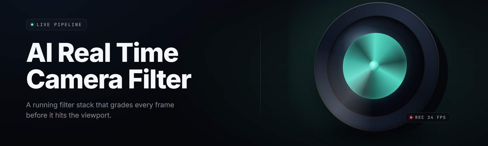

  
  
  

  

  
  

---

**AI Real-Time Camera Filter Generator 2026** — a native Windows `.exe` that turns any webcam, capture card, or virtual camera feed into a fully generated live filter pipeline. Face-tracked. Scene-aware. Neural-rendered. No scripts to write, no Python to install, no OBS plugin juggling. Launch the `.exe`, pick a filter, go live.

---

## 🎛️ Overview

| Category | Details |
|---|---|
| Product | AI Real-Time Camera Filter Generator |
| Package | `realtime-camera-filter-ai` |
| Engine | ONNX Runtime + custom TensorRT kernels |
| Capture backends | DirectShow, Media Foundation, NDI, OBS Virtual Cam |
| Output backends | Virtual Camera, NDI out, Spout/Syphon bridge, window preview |
| Latency target | 8–22 ms end-to-end @ 1080p60 on RTX 30-series |
| Model set | 41 shipped filter graphs (face, body, scene, style, broadcast) |
| Config format | `filters.json` + hot-reload watcher |
| Distribution | Standalone `.exe`, extract-and-run, no installer required |

The generator pulls raw frames from whatever capture source you point it at, runs them through a stacked neural pipeline — face landmarking, segmentation, style transfer, temporal denoise, LUT compositing — and pushes the result out to a virtual camera your streaming app already sees. Every stage is toggleable. Every filter is a `.onx` graph you can swap, chain, or remix.

  

---

## 🧩 What Is an "AI Real-Time Camera Filter Generator"?

| Term | Explanation |
|---|---|
| Filter Graph | A `.onx` file describing a chain of neural nodes (landmark → segment → style → composite) |
| Node | A single processing unit — face tracker, matte extractor, style transfer, colorizer, bloom |
| Virtual Camera | A DirectShow device the `.exe` registers so Zoom/Discord/OBS see the filtered feed |
| Temporal Denoise | Frame-history-aware smoothing that kills the flicker most real-time filters leave behind |
| Style Pack | A bundled set of style nodes (anime, cyberpunk, VHS, broadcast clean, clay, comic) |
| Live Swap | Switching graphs mid-stream without dropping a frame or resetting the virtual cam |
| Face Rig | The 478-point landmark model that drives warp, relight, and puppet filters |

Why builders reach for it:

- Frame history is kept on-GPU — no CPU round-trips, no stutter on scene cuts.
- Graphs compose; you can literally stack "cleanup → anime → VHS overlay" and it holds 60fps.
- The virtual camera is registered at launch — Discord, OBS, Streamlabs, Zoom all just see it.
- Every filter exports its parameters as JSON, so you can version your look in a repo.
- Hot-reload watches the folder; save the `.onx`, the feed updates in one frame.
- Ships with a headless mode for multi-cam rigs and automated broadcast pipelines.

---

## 🎞️ Key Features

| Feature | Description | Benefit |
|---|---|---|
| Live Neural Style Transfer | Per-frame style inference at 1080p60 | Anime/comic/paint looks with zero lag |
| 478-Point Face Rig | Dense landmark tracking + ARKit blendshapes | Puppet filters, face warp, relight |
| Background Matting v4 | Trimap-free, temporal-consistent matte | Green-screen quality without a green screen |
| Virtual Camera Bridge | DirectShow + MF virtual device | Drops straight into any streaming app |
| Graph Hot-Reload | Watches `.onx` folder, reloads in ~1 frame | Tweak looks live, no restart |
| Multi-Source Ingest | Webcam + NDI + capture card simultaneously | Switch cams without relaunching |
| GPU Frame History | 8-frame rolling buffer kept in VRAM | Flicker-free denoise and temporal styles |
| LUT Compositor | 3D LUT + neural color grade chain | Cinematic grades on top of neural looks |
| Headless CLI Mode | `--headless --graph battle.onx --out ndi` | Automate for broadcast rigs |
| Param Export/Import | Every filter serializes to `filters.json` | Version-control your entire look |
| Per-Node Telemetry | Live ms/frame readout per pipeline node | Find the bottleneck, tune it |
| Profile Auto-Switch | Recognizes app in focus, swaps graph | OBS gets broadcast, Discord gets fun |

---

## 🏗️ Grouped Module Catalog

**Face & Head Tracking Suite** — the landmark pipeline is the spine of every person-facing filter. It runs first, feeds everything downstream, and its output is what the warp, relight, and puppet nodes consume.

- **FaceRig478** — 478-point dense mesh, sub-2ms on RTX 3060
- **BlendshapeSolver** — ARKit-52 shape weights from the mesh
- **GazeTracker** — iris-relative gaze vector, 6DoF head pose
- **FaceOcclusionMask** — hair/hand/glasses occlusion handling
- **PuppetDriver** — bone-style rig for cartoon head swaps

**Scene & Background Intelligence** — everything that reasons about "what is not you." Segmentation, depth, and scene classification all live here.

- **MatteV4** — trimap-free soft matte, temporal-consistent
- **DepthLite** — monocular depth for parallax and bokeh
- **SceneClassifier** — indoor/outdoor/studio tagging drives auto-grades
- **SkyReplacer** — dedicated sky matte for window/outdoor cams
- **BokehSynth** — physically-plausible depth-of-field render

**Style & Render Nodes** — the actual "look." These are the nodes people remix into custom `.onx` graphs.

- **AnimeStyleV3** — GAN style transfer, edge-stable at 60fps
- **CyberpunkGrade** — neon bleed + chromatic aberration chain
- **VHS90** — scanline, chroma-shift, tape-noise emulation
- **ComicInk** — cel-shade with temporal edge coherence
- **ClayRender** — soft-body clay look with subsurface tint
- **PaintOil** — brush-stroke style transfer, motion-aware
- **BroadcastClean** — the "just make me look good" node, skin-tone aware

**Broadcast & Compositing** — the boring-but-critical stuff that makes a filtered feed usable as a real broadcast source.

- **LUTCompositor** — 3D LUT stacking, ACES-aware
- **ChromaKeyPro** — keyer with spill suppression and matte refine
- **LowerThirdAnchor** — landmark-locked overlay positioning
- **SafeAreaGuard** — action/title-safe overlay enforcement
- **FrameSync** — genlock-style frame alignment for multicam

**Capture & Output** — the plumbing. Point it at a source, point it at a sink.

- **SourceRouter** — webcam, NDI, capture card, file playback
- **VirtualCam** — DirectShow + Media Foundation device registration
- **NDIOut** — full NDI send at 1080p60
- **SpoutBridge** — zero-copy shared-texture handoff
- **WindowPreview** — always-on-top preview with GPU readback disabled

**Control & Automation** — for the people running this on a rig, not a laptop.

- **GraphHotReload** — folder watcher, one-frame swap
- **ProfileAutoSwitch** — foreground-app-aware graph selection
- **HeadlessRunner** — no UI, CLI-driven pipeline
- **TelemetryTap** — per-node latency + VRAM export
- **RemoteAPI** — localhost JSON control socket for external tooling
- **PresetLibrary** — 41 shipped graphs, import/export `.onx`

---

## ✅ Module Status

| Module | Status | Description |
|---|---|---|
| FaceRig478 | ✅ Working | 478-point landmark mesh, sub-2ms |
| MatteV4 | ✅ Working | Trimap-free temporal matte |
| AnimeStyleV3 | ✅ Working | Neural style transfer @ 60fps |
| VirtualCam | ✅ Working | DirectShow + MF device registration |
| NDIOut | ✅ Working | Full NDI send, 1080p60 |
| GraphHotReload | ✅ Working | One-frame `.onx` swap |
| HeadlessRunner | ✅ Working | CLI pipeline, no UI |
| TelemetryTap | ✅ Working | Per-node ms + VRAM export |
| ProfileAutoSwitch | ✅ Working | Foreground-app graph swap |
| RemoteAPI | ✅ Working | Localhost JSON control socket |
| PuppetDriver | ✅ Working | Cartoon bone-style head rig |
| BokehSynth | ✅ Working | Depth-driven DOF render |
| PresetLibrary | ✅ Working | 41 shipped `.onx` graphs |
| LUTCompositor | ✅ Working | 3D LUT stacking, ACES |
| DepthLite | ✅ Working | Monocular depth, 8ms |

---

## ⚙️ Compatibility / Platform Support

| Platform | Version | Support | Notes |
|---|---|---|---|
| Windows 11 | 22H2+ | ✅ Full | Primary target, all nodes |
| Windows 10 | 21H2+ | ✅ Full | All nodes, DX12 required |
| Windows 10 | LTSC 2019 | ⚠️ Partial | No NDI out, no VirtualCam |
| macOS | 13+ | ⚠️ Experimental | Spout/Syphon bridge only, no VirtualCam |
| Linux | Ubuntu 22.04+ | ⚠️ Experimental | v4l2 only, no VirtualCam, no headless GPU accel |
| OBS Studio | 29+ | ✅ Full | Sees VirtualCam as native device |
| Streamlabs | 1.16+ | ✅ Full | VirtualCam drop-in |
| Discord | Any | ✅ Full | Sees VirtualCam in video settings |
| Zoom | 5.14+ | ✅ Full | VirtualCam supported |
| NVIDIA GPU | RTX 20-series+ | ✅ Full | Optimal path, TensorRT accel |
| AMD GPU | RX 6000+ | ⚠️ Partial | DML path, ~40% slower |
| Intel GPU | Arc A-series | ⚠️ Partial | DML path, ~55% slower |

---

## 📖 Usage Guidelines

**Allowed**

- Streaming, recording, and video calls with generated filters
- Creative VJ sets and live performance visuals
- Kernel-level stream automation on rigs you own
- Researching real-time inference scheduling and GPU pipeline design
- Building custom `.onx` graphs and sharing them with the community

**Not allowed**

- Processing footage of people without their consent
- Bypassing platform-level identity or age verification using filter output
- Redistributing bundled model weights outside the repo's license terms
- Using the virtual camera to inject content into calls you weren't invited to
- Selling the `.exe` or its bundled models as your own product

---

## 🚀 Quick Start

1. 🎬 Grab the `.exe` from the download page.
2. 📦 Extract the archive to a folder on an SSD (not `Program Files`).
3. 🖱️ Double-click the `.exe` — first launch registers the virtual camera.
4. 🔌 Open OBS/Discord/Zoom, pick **"AI Real-Time Camera Filter"** as your video device.
5. 🎨 Pick a filter from the preset list, hit **▶ Start**, watch the feed.

---

## 🛠️ Tips for Best Results

- Run as Administrator on first launch so the virtual camera registers correctly.
- Keep the extraction folder on a fast SSD — model weights stream from disk on first use.
- Enable **GPU Frame History** in settings if you see flicker on stylized nodes.
- For 4K input, chain `DepthLite → BokehSynth` before style nodes to save VRAM.
- Update your NVIDIA driver to 552+ for TensorRT 9 kernels.
- Drop `.onx` files into `./graphs/` — the hot-reload watcher picks them up live.
- Turn off Windows "Camera privacy" blocks for the `.exe` before first run.
- Use `--headless` for rigs — the UI costs ~3ms/frame you don't need.

---

## 🧠 The Solution

| Problem | Solution |
|---|---|
| Neural filters lag behind the video | On-GPU frame history + TensorRT kernels keep 1080p60 under 22ms |
| Filter flickers on scene cuts | Temporal-consistent matte + denoise nodes ship enabled by default |
| Streaming apps can't see filtered output | DirectShow + MF virtual camera registers at launch |
| Tweaking a look needs a full restart | Graph hot-reload swaps `.onx` in one frame |
| Custom looks are trapped in the app | Every filter exports to `filters.json` + `.onx`, version-controllable |
| Multi-cam rigs need a NLE to switch | Source router handles webcam + NDI + capture simultaneously |

---

## 💡 Feature Categories

**Face & Identity** — the tracking layer is what makes a filter "understand" the subject. Every face node runs off the same 478-point rig, so downstream warp and puppet nodes are guaranteed consistent landmarks.

- **FaceRig478** — dense landmark mesh
- **BlendshapeSolver** — ARKit-52 output
- **GazeTracker** — iris + head pose
- **FaceOcclusionMask** — hair/hand/glasses handling
- **PuppetDriver** — cartoon head rig

**Scene & Depth** — separation, parallax, and background reasoning. This category is what turns a webcam into a proper compositing source.

- **MatteV4** — trimap-free matte
- **DepthLite** — monocular depth
- **SceneClassifier** — indoor/outdoor tagging
- **SkyReplacer** — sky-specific matte
- **BokehSynth** — depth-driven DOF

**Style & Render** — the actual look. All GAN/temporal nodes live here and are the ones people remix most.

- **AnimeStyleV3** — edge-stable GAN style
- **CyberpunkGrade** — neon grade chain
- **VHS90** — tape emulation
- **ComicInk** — cel-shade
- **ClayRender** — clay look
- **PaintOil** — brush strokes
- **BroadcastClean** — clean-up node

**Broadcast & Compositing** — overlays, keys, color, sync. The nodes that make the output usable as an actual broadcast source.

- **LUTCompositor** — ACES-aware LUT stack
- **ChromaKeyPro** — keyer + spill suppress
- **LowerThirdAnchor** — landmark-locked overlay
- **SafeAreaGuard** — safe-area enforcement
- **FrameSync** — multicam sync

**Capture & Output** — sources and sinks. Webcams, NDI, capture cards in; virtual cam, NDI, Spout out.

- **SourceRouter** — multi-source ingest
- **VirtualCam** — DX + MF device
- **NDIOut** — full NDI send
- **SpoutBridge** — shared-texture handoff
- **WindowPreview** — always-on-top preview

**Control & Automation** — for rigs and CI. Everything that makes the tool run without a human touching it.

- **GraphHotReload** — folder watcher
- **ProfileAutoSwitch** — app-aware swap
- **HeadlessRunner** — CLI mode
- **TelemetryTap** — latency export
- **RemoteAPI** — localhost control
- **PresetLibrary** — 41 shipped graphs

---

## ⚖️ Comparison

| Aspect | Typical OBS Filter | Generic Web Filter | This Tool |
|---|---|---|---|
| Neural style transfer | ❌ | ⚠️ Cloud-only | ✅ On-GPU, live |
| Face landmark tracking | ❌ | ⚠️ Browser only | ✅ 478-point, sub-2ms |
| Virtual camera output | ✅ via plugin | ❌ | ✅ Native device |
| Latency @ 1080p60 | n/a | 200ms+ (upload) | 8–22 ms |
| Custom look workflow | LUT file only | Locked presets | `.onx` graph, hot-reload |
| Multi-source ingest | ⚠️ One source | ❌ | ✅ Webcam+NDI+capture |
| Headless / CLI mode | ❌ | ❌ | ✅ `--headless` |
| Param export | ⚠️ Partial | ❌ | ✅ `filters.json` |

---

## 🖥️ System Requirements

| Component | Minimum | Recommended |
|---|---|---|
| OS | Windows 10 21H2 | Windows 11 22H2+ |
| CPU | 6-core x86_64 | 8-core / 16-thread |
| RAM | 8 GB | 16 GB |
| GPU | GTX 1660 6GB | RTX 3060 12GB+ |
| VRAM | 4 GB | 8 GB+ |
| Storage | 4 GB free SSD | 8 GB free NVMe |
| DirectX | 12 | 12 Ultimate |
| Driver | NVIDIA 535+ / AMD 23.x | NVIDIA 552+ |
| Capture source | Any UVC webcam | 1080p60 webcam or capture card |

---

## 📥 Installation

1. **Download the archive.** Grab the latest `.exe` build from the project download page.
2. **Extract to a writable folder.** Right-click → Extract All → choose a folder like `D:\ai-cam-filter\`. Do not use `Program Files` — the `.exe` writes to its own folder.
3. **First launch.** Right-click the `.exe` → Run as Administrator. On first launch the `.exe` registers the DirectShow virtual camera device and unpacks the 41 bundled `.onx` graphs into `./graphs/`.

---

## 🧯 Known Issues

| Issue | Solution |
|---|---|
| Virtual camera not visible in OBS | Run as Administrator once, then relaunch OBS — DX device registration requires elevated first-run |
| Flicker on anime-style nodes | Enable **GPU Frame History** in settings, set buffer to 8 |
| High CPU usage on AMD build | DML path is less efficient than TensorRT — prefer NVIDIA for 60fps |
| `.onx` file not hot-reloading | Confirm the file is in `./graphs/` and extension is lowercase `.onx` |
| NDI out not detected by receiver | Ensure NDI Runtime 5+ is installed; check Windows Firewall for UDP 5960 |
| Preview window stutters but output is smooth | Preview uses GPU readback — disable it in settings, it's only for troubleshooting |

---

## ❓ FAQ

| Question | Answer |
|---|---|
| Is this free? | Yes — MIT licensed, no account, no telemetry. |
| Do I need Python or Node installed? | No. The `.exe` is fully standalone — extract and run. |
| Does it work with OBS? | Yes — OBS 29+ sees the virtual camera as a native device. |
| Will this get me banned on a platform? | The output is a video feed. It's the content, not the tool, that platforms moderate. |
| Does it need a GPU? | Yes, a dedicated GPU is required. GPU is the whole point — CPU fallback is not shipped. |
| Can I chain multiple filters? | Yes — that's the `.onx` graph system. Stack style nodes, save as your own graph. |
| How do I make my own filter? | Chain nodes in the graph editor, save as `.onx` to `./graphs/`, hot-reload picks it up. |
| Does it work offline? | Yes. No cloud inference, no phone-home. Everything is on-GPU, locally. |
| Can I run multiple instances? | One instance per virtual camera slot. Use `--headless` for additional pipelines on separate sources. |
| Where are settings stored? | In the extraction folder as `filters.json` and `settings.json` — portable, no registry writes. |

---

## 🧭 Roadmap Notes

Version 2.4.1 is the current stable release line. The next minor is focused on the AMD DML path (targeting parity with the TensorRT pipeline) and a Linux VirtualCam shim for the v4l2 loopback driver. Filter graph format stays backwards-compatible — any `.onx` you build today keeps working.

---

## 🔗 Where to Go Next

- The project page holds the download and changelog.
- The `./graphs/` folder after first launch holds all 41 shipped presets.
- The `filters.json` and `settings.json` in the extraction folder hold your entire setup.
- Community graph packs go in the same `./graphs/` folder — hot-reload handles the rest.

Point the `.exe` at a camera, pick a graph, and your feed is already filtered before you've finished reading this line.

  

